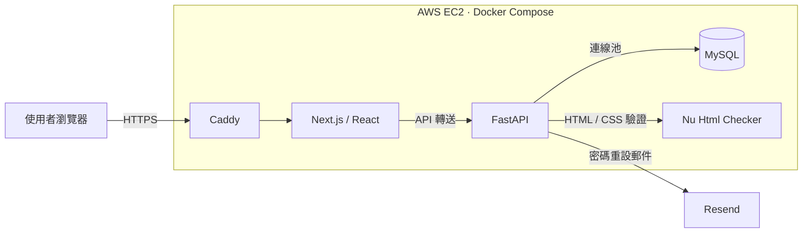
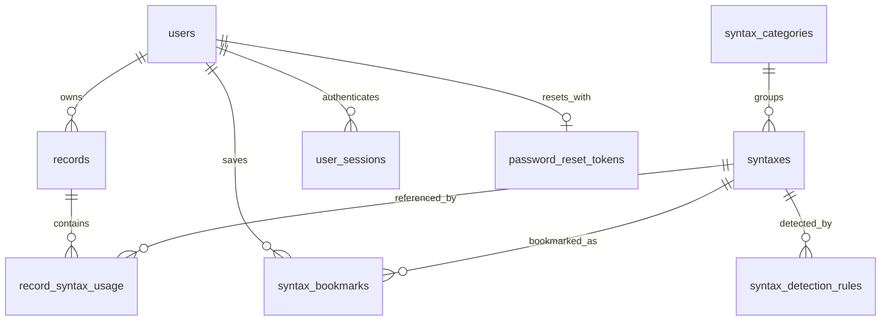
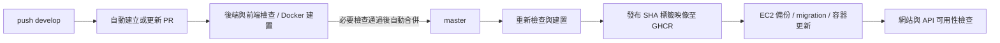

# Syntax Atlas｜我的語法足跡

提供 Python、HTML 與 CSS 程式碼分析及語法查閱的學習平台。貼上程式碼後，可以查看辨識到的語法、中文說明、範例與官方文件；登入後可保存練習、收藏語法，並回顧累積使用次數與語言占比。

**[前往網站](https://syntax.sammics.cc/)** · **[版本紀錄](https://github.com/sammics91/syntax-atlas/releases)**

## 開發動機

練習程式時，常會記得某個效果曾經實作過，卻忘記使用了哪些語法。Syntax Atlas 將當次分析、語法查閱與個人練習紀錄連接起來，方便從實際寫過的程式碼回顧語法，也探索尚未使用的項目。

## 主要功能

| 功能 | 說明 |
| --- | --- |
| 程式碼分析 | 支援純 Python、HTML 文件與片段、純 CSS，以及 HTML 中的 `<style>` 區塊與 `style` 屬性 |
| 程式碼編輯器 | 使用 CodeMirror 6，支援語法上色、Tab 縮排與長行折行 |
| 語法辭典 | 依語言切換、跨語言搜尋，查看中文說明、範例與官方來源連結 |
| 會員與收藏 | 註冊、登入、登出、會員資料與密碼修改、密碼重設、帳號註銷及語法收藏 |
| 練習紀錄 | 儲存與編輯程式碼，使用會員專屬的 `#n` 編號辨識紀錄 |
| 兩種刪除模式 | 僅移除程式碼並保留統計，或完全刪除紀錄及其統計貢獻 |
| 個人統計 | 依已儲存紀錄彙總語法使用排名與語言占比 |
| 響應式介面 | 配合桌機、平板及手機調整導覽、語法名稱與程式碼呈現 |

### 計次定義

統計的是**原始碼中已收錄語法的出現次數**，不是程式實際執行次數，也不是程式碼行數或長度。

- **Python**：以 AST 與 token 辨識。例如 `for` 寫一次就計一次，不因迴圈執行多次而增加。
- **HTML**：只計實際寫出的起始標籤，不計結束標籤，也不計解析器或驗證外框補上的標籤。
- **CSS**：依實際宣告計次；`margin` 不展開成四個長寫屬性重複加算。選擇器依組成計次，自訂屬性合併為 `--*`，巢狀 `var()` 分別計次。
- **語言占比**：該語言的已辨識次數 ÷ 全部語言的已辨識次數。常用語法頁使用已儲存紀錄的累積結果，排名長條以第一名為滿格。

## 系統架構



| 層級 | 使用技術與用途 |
| --- | --- |
| 前端 | Next.js、React、TypeScript、CSS Modules、React Context、CodeMirror 6 |
| API | Python、FastAPI、Pydantic |
| 語法處理 | Python AST／tokenize、html5lib、HTMLParser、tinycss2 |
| 驗證服務 | 獨立容器執行 Nu Html Checker，提供 HTML 與 CSS 驗證 |
| 資料儲存 | MySQL、mysql-connector-python 連線池 |
| 部署 | Docker Compose、AWS EC2、Caddy HTTPS、GHCR |
| 自動化 | GitHub Actions：PR 檢查、映像發布、資料庫更新與部署 |

本機 Compose 連接主機上的 MySQL；正式環境沿用 EC2 上的 MySQL 與 Caddy 服務，由發布設定更新應用程式與驗證器。

## 技術重點

### 1. 多語言驗證與統一計次結果

不同語言交由對應解析器處理，再將結果對應到資料庫中的語法 ID 與啟用規則。各分析器回傳一致的欄位，包括 `syntax_id`、`language`、`name`、`count` 與說明、範例，供前端展示及紀錄儲存使用。

HTML 中的 CSS 依 `<style>` 與 `style` 屬性的明確邊界拆出，驗證與分析後，再以語言及語法 ID 合併次數。使用者內容只做靜態解析，不執行貼上的程式碼；語法不合法與驗證服務無法使用，也分別回應。

相關實作：[Python 分析器](backend/analyzer.py)、[HTML 分析器](backend/analyzer_html.py)、[CSS 分析器](backend/analyzer_css.py)、[分析 API](backend/main.py)。

### 2. 編輯與刪除後仍維持統計一致

儲存與編輯時由後端重新分析程式碼，不直接信任前端傳入的計次結果。

- **新增**：以 `SELECT ... FOR UPDATE` 鎖定會員的下一筆紀錄編號，將編號更新、紀錄及語法明細放在同一個交易提交。
- **編輯**：鎖定該會員的紀錄，替換舊的語法明細，避免反覆編輯導致統計重複累加。
- **僅移除程式碼**：清除程式碼內容，保留 `record_syntax_usage`，讓既有統計持續存在。
- **完全刪除**：刪除紀錄，透過外鍵連帶移除該筆語法明細。

個人資料操作由後端 Session 取得會員身分，並檢查紀錄擁有權。連線池預設為每個後端程序 5 條連線，可透過 `DB_POOL_SIZE` 調整；連線池滿載時回應 503。

相關實作：[紀錄 API](backend/records.py)、[統計 API](backend/syntax_statistics.py)、[資料庫連線](backend/database.py)。

## 核心資料關係



- 語法分類以 `(language, slug)` 唯一識別；分類內的語法以 `(category_id, slug)` 唯一識別。
- 紀錄使用資料庫 `id` 作為 API 識別，另以 `(user_id, record_number)` 保持會員專屬編號唯一。
- 每筆紀錄的語法明細以 `(record_id, syntax_id)` 為複合主鍵。

建表 SQL 與更新流程位於 [backend/database](backend/database)。

## 官方資料與資料庫更新

語法內容參考 Python 3.13 官方文件第 6～8 章、HTML Living Standard，以及 W3C／CSS Working Group 規範。擷取資料後整理中文名稱、摘要、範例與辨識規則，保留來源連結及版本資訊，再產生 SQL 更新。

`migrate.py` 按編號執行更新，以檔名與 SHA-256 checksum 記錄已套用的檔案；已套用的檔案若遭修改，會停止並要求新增 migration。語法匯入以唯一鍵更新既有項目，保留其 ID。

## CI/CD



- 後端檢查涵蓋 Python 語法、映像內 API 載入及 migration 檔案檢查；前端執行 ESLint、TypeScript 檢查與 Docker 建置。
- GitHub Actions 使用 OIDC 取得 AWS 短效憑證，暫時放行當次 runner 的 SSH 來源 IP；部署仍透過 SSH 進行，結束後撤銷該規則。
- EC2 部署腳本使用互斥鎖，先備份 MySQL，再套用 migration、更新容器並檢查可用性。
- 映像以完整 commit SHA 對應程式版本；Release 提供版本說明與來源標記。

工作流程位於 [.github/workflows](.github/workflows)，部署腳本位於 [deploy/deploy.sh](deploy/deploy.sh)。

## 本機執行

以下以 **Windows + Docker Desktop** 為例。需先啟動 Docker Desktop，並準備可供容器連線的 MySQL 8 資料庫；Compose 不會另外建立 MySQL。

### 1. 準備資料庫與環境變數

在本機 MySQL 建立開發資料庫，例如：

```sql
CREATE DATABASE syntax_atlas
  CHARACTER SET utf8mb4
  COLLATE utf8mb4_0900_ai_ci;
```

在專案根目錄執行，僅在尚無設定檔時建立：

```powershell
if (!(Test-Path backend/.env)) {
  Copy-Item backend/.env.example backend/.env
}
```

編輯 `backend/.env` 的資料庫帳號、密碼、名稱與連接埠。執行建表與 migration 的帳號需具備相應權限。

- 容器的 `DB_HOST` 由 Compose 設為 `host.docker.internal`。
- 若使用 Docker 網址測試密碼重設，將 `PUBLIC_APP_URL` 設為 `http://localhost:8081`，並填入自己的 `RESEND_API_KEY` 與已驗證寄件者 `MAIL_FROM`。
- 未設定寄信服務時，密碼重設郵件功能無法使用。

### 2. 建置映像並初始化開發資料庫

```powershell
docker compose -p syntax-atlas-dev build
docker compose -p syntax-atlas-dev run --rm --no-deps backend python migrate.py
docker compose -p syntax-atlas-dev run --rm --no-deps backend python migrate.py --apply
```

第一個 migration 指令只檢查檔案；加上 `--apply` 才會連線、建表並套用語法資料與其他更新。請使用自己的開發資料庫。

### 3. 啟動服務

```powershell
docker compose -p syntax-atlas-dev up -d
```

開啟 **http://localhost:8081**。HTML 與 CSS 分析需等待 Nu 驗證器啟動完成。

```powershell
# 查看狀態與後端日誌
docker compose -p syntax-atlas-dev ps
docker compose -p syntax-atlas-dev logs --tail 100 backend

# 停止並移除本次容器與網路
docker compose -p syntax-atlas-dev down
```

`down` 不會移除主機 MySQL 資料或已建置映像。映像不包含環境設定檔與會員資料。

## 目前限制

- 語言自動辨識仍可能對缺乏明確結構的片段產生歧義，例如 `var(--a, var(--b))` 也可能被解析為 Python 運算式。
- 尚未提供 JavaScript 語法分析；辨識 `<script>` 標籤不代表已分析其中的 JavaScript。
- CSS 驗證受固定版本 Nu 的支援範圍限制；遇到無法確認的語法會提示並停止分析，不宣稱支援全部 CSS 規範。
- 辭典與統計僅涵蓋已收錄且啟用的項目，不能據此推論整份程式碼的語言構成或使用者熟練度。
- CI 的載入與建置檢查不等同完整端到端測試；部署可用性檢查也不代表所有功能皆已驗證。
- 部署失敗會停止，不會自動還原資料庫；MySQL DDL 亦不保證能隨整次 migration 回滾。
